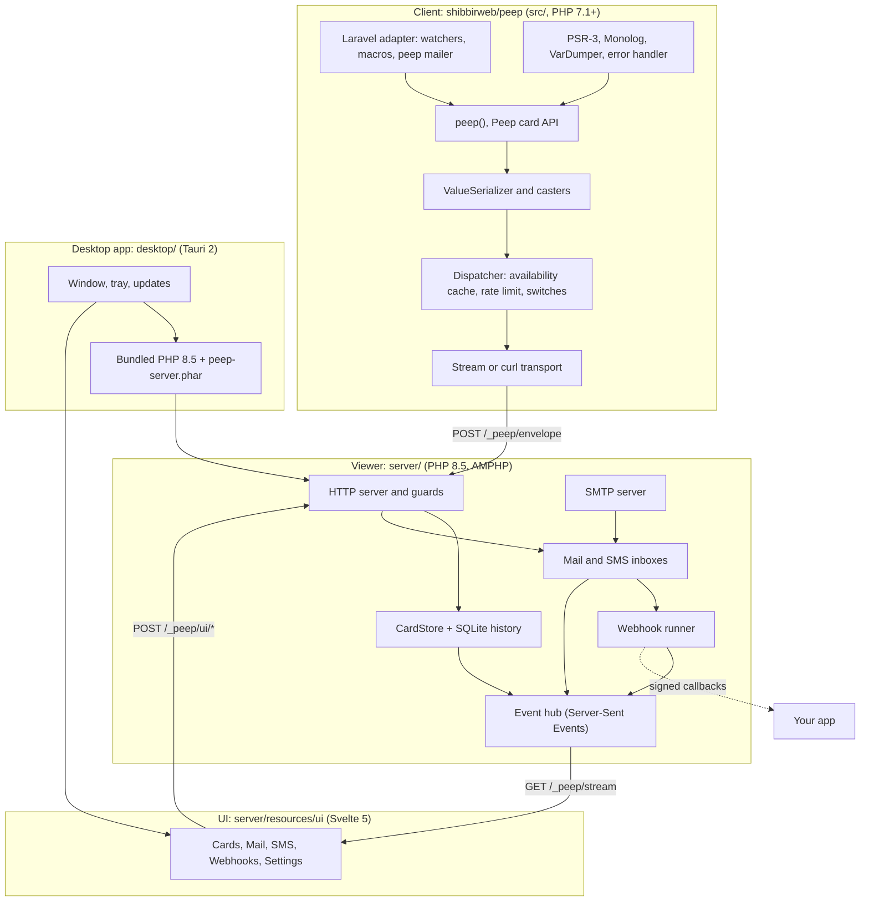
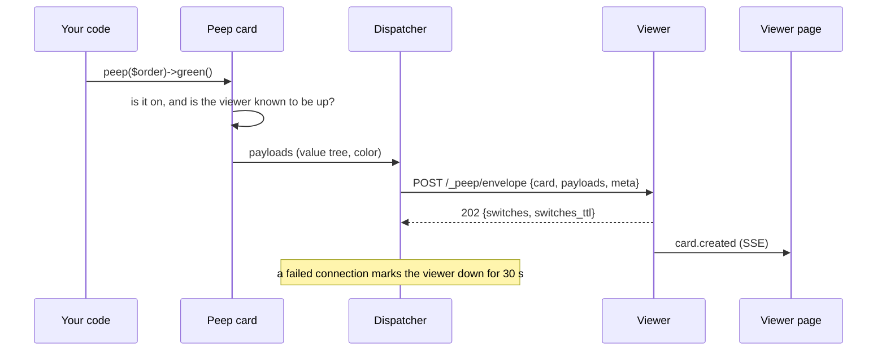

# Architecture

One repository, three programs, one protocol between them.

## One `peep()` call

## Where things live

| Folder | What | Notes |
|--------|------|-------|
| `src/` | The client, the only Packagist package | PHP 7.1 syntax, no `declare(strict_types)`, no warnings on any PHP |
| `src/Laravel/` | Laravel adapter | Auto-discovered; registers nothing when Peep is off |
| `server/` | The viewer | PHP 8.5, AMPHP v3; shipped as `peep-server.phar`, not on Packagist |
| `server/resources/ui/` | The viewer page | Svelte 5, built with Bun and Vite into `server/public/` |
| `desktop/` | The desktop app | Tauri 2, Rust; runs the viewer as a sidecar |
| `scripts/` | Release, wiki and screenshot scripts | Bun |
| `docs/wiki/` | This wiki | Published by CI |

The [protocol](Protocol.md) is the contract between the client and the viewer; the plan documents in `docs/plan/` explain each feature's design.
