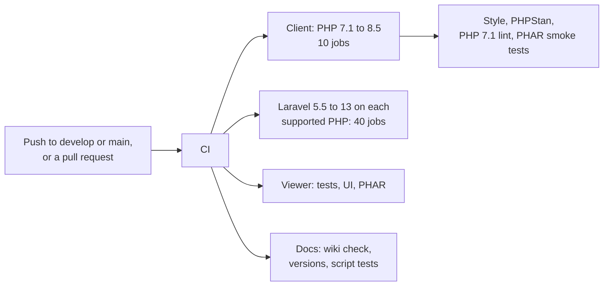

# Contributing

## Set up

```bash
git clone https://github.com/shibbirweb/peep.git && cd peep
git switch develop                       # work starts from develop
composer install                         # the client
composer tools:install                   # PHPStan, PHP-CS-Fixer, PHPCompatibility, Box, Testbench
(cd server && composer install && composer build:ui)   # the viewer (PHP 8.5, Bun)
```

Run the viewer from source with `php server/bin/peep-server serve`.

## Rules that matter here

- The client runs on PHP 7.1 to 8.5 with the same code: no 7.2+ syntax, newer functions behind a runtime check, and no warnings or deprecations on any version (the tests fail on them).
- Code style: PSR-12 for the client, PER-CS 2.0 for the viewer. `composer check` runs tests, style, PHPStan and the PHP 7.1 compatibility check.
- Commits: `feat:[ID] summary` or `fix:[ID] summary` with the feature id from `docs/plan/features.md`; `docs:` and `chore:` for the rest. A `feat!:` marks a breaking change.
- Every user-visible change gets a line under **Unreleased** in `CHANGELOG.md`, in the same pull request: it becomes the release notes.
- Pull requests go into `develop`.

## Tests

| Command | Runs |
|---------|------|
| `composer test` | Client tests (PHPUnit 7.5 to 12, whichever your PHP installs) |
| `composer test:laravel` | Laravel tests, in a copy with Testbench installed (see below) |
| `cd server && composer check` | Viewer tests, style, PHPStan |
| `cd server && composer test:ui` | Viewer page tests (Bun) |
| `cd desktop/src-tauri && cargo test` | Desktop app tests |
| `bun test scripts` | Release and wiki script tests |
| `bun scripts/build-wiki.ts --check` | Wiki pages, links and screenshots |

For one Laravel version, install its Testbench in a copy of the repository: `composer remove --dev yoast/phpunit-polyfills phpunit/phpunit && composer require --dev "orchestra/testbench:^9.0"` (Laravel 11), then `composer test:laravel`.

## What CI runs



Every job runs at the same time, so CI takes about as long as its slowest job. The Laravel matrix is every Laravel version on every PHP version it supports ([Version support](../usage/Version-Support.md)). Pull requests that touch `desktop/` or `server/` also build the desktop apps.
