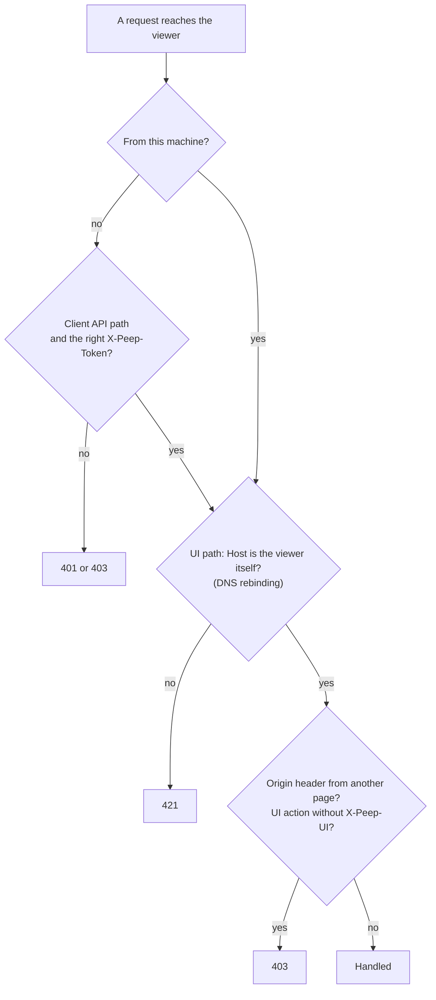

# Protocol

The client and the viewer speak a small HTTP and JSON protocol, version 1. The full specification, with every payload type and the value tree format, is [docs/protocol.md](../../protocol.md); this page is the overview.

| Endpoint | Used by | For |
|----------|---------|-----|
| `GET /_peep/health` | client, tools | Is a Peep viewer listening? |
| `POST /_peep/envelope` | client | One card's payloads |
| `GET /_peep/switches?project=` | client | Query switches when nothing was sent lately |
| `GET /_peep/locks/{name}` | client | Polling a `pause()` |
| `POST /_peep/mail`, `/_peep/sms` and the Mailgun, Twilio and Vonage paths | any app | Caught mail and SMS |
| `GET /_peep/stream` | viewer page | Server-Sent Events |
| `POST /_peep/ui/*` | viewer page | Actions, with the `X-Peep-UI` header |
| `GET /_peep/ui/logs/*`, `POST /_peep/ui/logs/folder` | Logs tab | Log folders, files and parsed entries |
| `GET /_peep/agent/*`, `POST /_peep/agent/clear` | `peep` command, MCP server | Cards, a debug report, mail and SMS as text for [AI agents](../usage/AI-Agents.md) |

An envelope:

```json
{
  "protocol": 1,
  "card": "8f14e45f-...",
  "payloads": [
    { "type": "log", "content": { "values": [ { "type": "string", "value": "hello", "length": 5 } ] }, "origin": { "file": "/app/src/UserService.php", "line": 42 } },
    { "type": "color", "content": { "color": "green" } }
  ],
  "meta": { "project": "shop", "hostname": "dev", "php_version": "8.4.12", "peep_version": "1.0.0", "request": { "id": "...", "kind": "http", "label": "POST /users", "started_at": 1792663321.5 }, "sent_at": 1792663321.7 }
}
```

## Safety rules



Mail HTML and `html()` payloads are shown in sandboxed frames without scripts; attachments are always downloads. Sensitive keys (`password`, `token`, `authorization` and more) are redacted in the client, before anything leaves the app.
