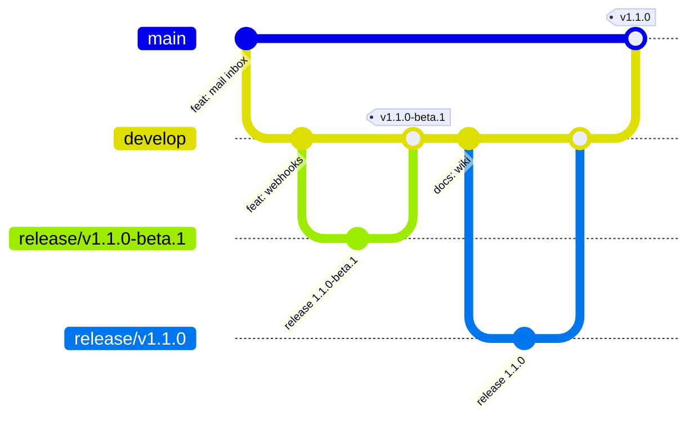
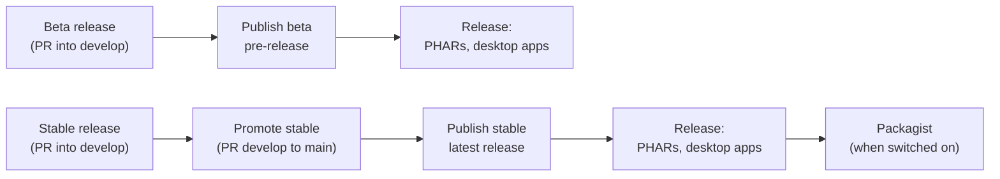

# Releasing

Releases are cut by workflows, never by hand. `develop` is the beta line and `main` is stable; every change, releases included, reaches `develop` by pull request first.



## A beta

1. Write the changes under **Unreleased** in `CHANGELOG.md` as they land.
2. Actions, **Beta release**, Run workflow on `develop`. It works out the version (`bun scripts/version.ts bump beta`: from 1.0.0, 1.1.0-beta.1, or 1.0.1-beta.1 when only fixes landed, 2.0.0-beta.1 for a `feat!:`), and opens a release pull request with the notes.
3. Merge it. Once CI passes on `develop`, **Publish beta** publishes the GitHub pre-release with the Unreleased notes, and **Release** builds `peep.phar`, `peep-server.phar` and the desktop apps and attaches them. Desktop installs on the beta channel are offered it.

## A stable release

1. Actions, **Stable release**, Run workflow on `develop`. It only finishes a published beta with nothing untried on top (docs, tests and chores may land in between), dates the changelog into `## [1.1.0] - YYYY-MM-DD`, and opens the release pull request.
2. Merge it. Once CI passes on `develop`, **Promote stable** opens the pull request from `develop` into `main`. Merge it with a merge commit.
3. Once CI passes on `main`, **Publish stable** publishes the release (marked latest) with the version's changelog section as notes, and **Release** builds and attaches everything and updates Packagist.



Every step can be re-run from Actions; **Release** also rebuilds an existing release from its tag.

## version.ts

```bash
bun scripts/version.ts show            # 1.1.0-beta.1
bun scripts/version.ts check           # every file carries the same version
bun scripts/version.ts pending         # what the next release would be
bun scripts/version.ts notes 1.1.0     # that version's release notes
bun scripts/version.ts bump minor      # beta | release | patch | minor | major | x.y.z
```

The version lives in `src/Version.php` (the source of truth), `server/src/Version.php`, `desktop/src-tauri/tauri.conf.json`, `desktop/package.json`, `desktop/src-tauri/Cargo.toml`, `Cargo.lock`, and the release tag in the README's tour video links (so each branch plays its own version's video). CI fails when they disagree.

## Repository settings

| Setting | Why |
|---------|-----|
| General: default branch `develop` | Pull requests target `develop`, and the workflows started by CI finishing (Publish beta, Promote stable, Publish stable) run from `develop`'s copy, so a fix to them applies once it is merged there |
| Actions, General: "Allow GitHub Actions to create and approve pull requests" | Beta and Stable release open pull requests |
| Variable `PACKAGIST_AUTO_PUBLISH` = `true`, secrets `PACKAGIST_USERNAME`, `PACKAGIST_TOKEN` | Release creates the Packagist package on the first release and updates it on every one after |
| Secrets `APPLE_CERTIFICATE`, `APPLE_CERTIFICATE_PASSWORD`, `APPLE_SIGNING_IDENTITY`, `APPLE_ID`, `APPLE_PASSWORD`, `APPLE_TEAM_ID` | Signed and notarized macOS apps |
| Secrets `WINDOWS_CERTIFICATE`, `WINDOWS_CERTIFICATE_PASSWORD`, variable `WINDOWS_CERTIFICATE_THUMBPRINT` | Signed Windows installers |
| Secrets `TAURI_SIGNING_PRIVATE_KEY`, `TAURI_SIGNING_PRIVATE_KEY_PASSWORD`, variable `TAURI_UPDATER_PUBKEY` | Desktop apps that install their own updates (`cd desktop && bun run tauri signer generate`) |
| Branch protection on `develop` and `main`: pull requests, CI passing | Nothing reaches users untested |

Without the signing secrets the builds are unsigned; without the update key the desktop app opens the download page instead of installing.
