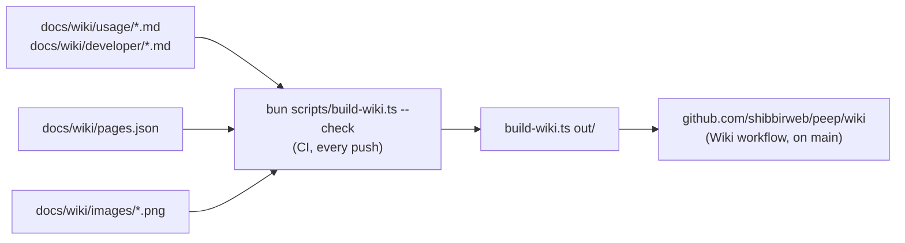

# Wiki and screenshots

This wiki is written in the repository, in `docs/wiki/`, and published to GitHub's wiki by CI. Change it in a pull request like code.



## Writing a page

- Add the file under `usage/` (for people using Peep) or `developer/` (for people working on it) and list it in `pages.json` with a one-line summary; the order there is the order in the sidebar.
- Start with a `# Title` line. Keep a page under 1,200 words; split longer ones.
- Link other pages by file name: `[Laravel](Laravel.md)`, `[Releasing](../developer/Releasing.md#a-beta)`. Link repository files by path: `[the protocol](../../protocol.md)`; they become links to GitHub.
- Diagrams are Mermaid blocks (` ```mermaid `), which GitHub draws.
- No em-dashes.

The check fails on a missing or unlisted page, a broken link, a missing or unused image, a page without a title, a page over the word limit, and an unknown Mermaid diagram type.

## Screenshots

```bash
cd server && composer install && composer build:ui && cd ..
bun scripts/screenshots.ts            # every screenshot
bun scripts/screenshots.ts mail sms   # only these
```

The script starts a viewer with a scratch settings folder, sends the demo shop app's data (`scripts/screenshots/demo.php`, with the small app in `scripts/screenshots/app/`), starts an app for the webhooks to call, and takes each screenshot with headless Chrome (`CHROME=/path/to/chrome` if it is not in the usual place). Retake them when the viewer's look changes, and commit the PNGs.

## The feature tour video

```bash
bun scripts/video.ts                  # demo/peep-tour.mp4 and its poster demo/peep-tour.png
bun scripts/video.ts --poster         # only the poster
```

`scripts/video.ts` uses the same demo (both scripts share `scripts/demo.ts`), records the viewer with Chrome's screencast while a drawn cursor clicks and types through the main features, captions each scene with what it saves you, and ends with `vendor/bin/peep report` in a terminal. ffmpeg (needed) lays the frames on an exact 30 fps timeline, joins the scenes with transitions, and adds the music.

The music comes from `scripts/music.ts`: an upbeat electronic track synthesized sample by sample (kick, clap, hats, bass, chords, arpeggio; 124 BPM in A minor), with the drop on the first cut and a whoosh on every transition. Nothing in it is sampled or copied, so the video can go to YouTube or anywhere else without a license or a Content ID claim. It is mixed to about -14 LUFS with peaks near -1 dB.

The README shows the poster and plays the video in `demo/` (kept out of the Composer package) through jsDelivr, at the release tag: `cdn.jsdelivr.net/gh/shibbirweb/peep@v<version>/demo/...`. GitHub serves an MP4 from a repository only as a download, while jsDelivr serves it as `video/mp4`, so it plays in the browser. The tag in those links is one of the places `scripts/version.ts` keeps in step with the version, so `main` and `develop` each play the video of the version they are at; between merging a release pull request and its tag being created, the links wait for the tag. Record it again when the viewer changes; `TOUR_TIMES=1` prints when each scene starts and where it cuts, and `TOUR_KEEP=1` keeps the in-between files.

## Publishing

The Wiki workflow publishes on every push to `main` that changes the wiki, and "Run workflow" publishes from any branch. The wiki must exist first: open the Wiki tab on GitHub once and save any page; the next publish replaces it.
