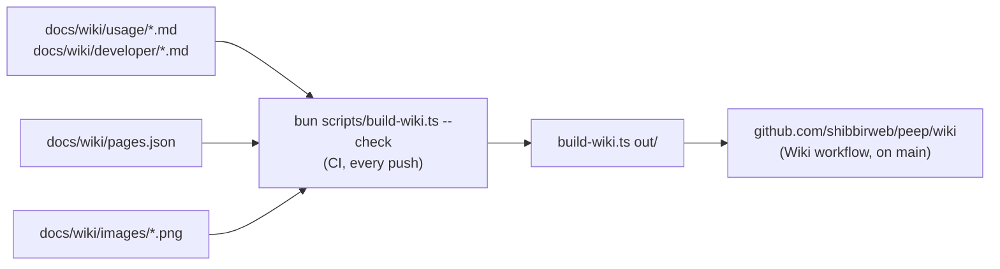

# Wiki and screenshots

This wiki is written in the repository, in `docs/wiki/`, and published to GitHub's wiki by CI. Change it in a pull request like code.



## Writing a page

- Add the file under `usage/` (for people using Peep) or `developer/` (for people working on it) and list it in `pages.json` with a one-line summary; the order there is the order in the sidebar.
- Start with a `# Title` line. Keep a page under 1,200 words; split longer ones.
- Link other pages by file name: `[Laravel](Laravel.md)`, `[Releasing](../developer/Releasing.md#a-beta)`. Link repository files by path: `[the protocol](../../protocol.md)`; they become links to GitHub.
- Diagrams are Mermaid blocks (` ```mermaid `), which GitHub draws.
- No em-dashes.

The check fails on a missing or unlisted page, a broken link, a missing or unused image, a page without a title, a page over the word limit, and an unknown Mermaid diagram type.

## Screenshots

```bash
cd server && composer install && composer build:ui && cd ..
bun scripts/screenshots.ts            # every screenshot
bun scripts/screenshots.ts mail sms   # only these
```

The script starts a viewer with a scratch settings folder, sends the demo shop app's data (`scripts/screenshots/demo.php`, with the small app in `scripts/screenshots/app/`), starts an app for the webhooks to call, and takes each screenshot with headless Chrome (`CHROME=/path/to/chrome` if it is not in the usual place). Retake them when the viewer's look changes, and commit the PNGs.

## Publishing

The Wiki workflow publishes on every push to `main` that changes the wiki, and "Run workflow" publishes from any branch. The wiki must exist first: open the Wiki tab on GitHub once and save any page; the next publish replaces it.
