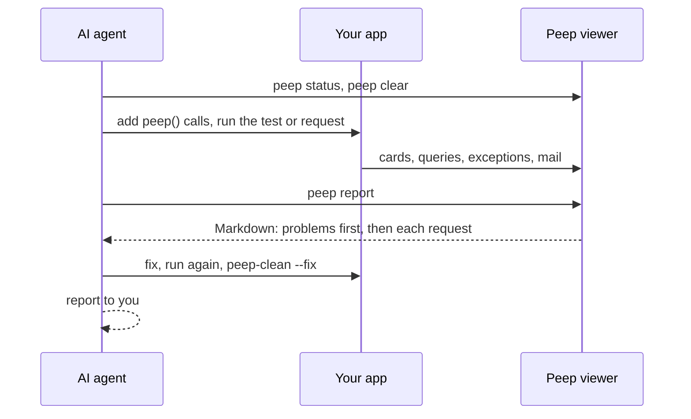

# AI agents

An AI coding agent (Claude Code, Codex, Cursor, Copilot, Gemini CLI and others) can debug your app with Peep the way you do: add `peep()` calls, run the code, read what Peep caught, fix the bug, and give you a report. It reads the viewer through the `peep` command or through Peep's MCP server, as plain text.

Tell it, for example:

> Use Peep to find out why checkout fails for orders with a coupon, fix it, and show me the report.

## How it works



The viewer must be running (the desktop app or `php peep-server.phar serve`) and Peep must be on in the app, as for any debugging with Peep.

## Give the agent the skill

The Peep skill is the agent's manual: how to check the viewer, instrument code, reproduce, read the report, clean up and report back.

```bash
vendor/bin/peep skill --install     # writes .claude/skills/peep/SKILL.md (Claude Code finds it there)
vendor/bin/peep skill               # prints it, to copy into another agent's skills folder or rules
```

The skill follows the [Agent Skills](https://agentskills.io) format, so agents that read skills use it as it is. For an agent without skills, add one line to its rules file (`AGENTS.md`, `.cursor/rules`, `GEMINI.md`): "To debug PHP, follow .claude/skills/peep/SKILL.md."

## The command line

`vendor/bin/peep` comes with the package (with a [global install](Global-Install.md): `php ~/.peep/peep.phar`). It finds the viewer the way the app does: `peep.php`, `PEEP_HOST`, `PEEP_PORT`, `PEEP_TOKEN`.

| Command | Shows or does |
|---------|---------------|
| `peep status` | Whether the viewer runs, each project with its cards, mail and SMS, and the query switches |
| `peep report` | A Markdown debug report: problems (exceptions, failed jobs, error responses, failed HTTP calls, error logs, error entries in the log file, slow and repeated queries), then every request with its cards, then mail and SMS. `--output=FILE` also saves it |
| `peep cards` | The newest cards as text, oldest first |
| `peep mail`, `peep sms` | Caught mail and SMS; `peep mail --id=ID` shows one mail with its body |
| `peep logs` | The app's log file (the newest in `storage/logs`): `--file=NAME`, `--level=error` for errors and worse, with context and stack traces |
| `peep webhooks` | The webhook rules you made in the viewer and the calls they made with the app's answers: `--rule=NAME`, `--id=ID` for one call with its request and response |
| `peep send-webhook` | Calls the app with one of your rules, signed like the provider: `--rule=NAME --event=delivered` sends one call now and shows the answer; without `--event`, every step of the rule runs on its schedule. `--mail=ID` or `--sms=ID` (`last` for the newest) uses a caught message, otherwise sample data |
| `peep wait` | Waits for new cards and shows them (`--timeout=30`, `--count=1`): for a page the user clicks or a queued job |
| `peep clear` | Empties the viewer before a run (`--what=all`, `cards`, `mail`, `sms` or `webhooks`) |
| `peep mcp` | The MCP server |

Filters for `report`, `cards`, `mail`, `sms`, `logs`, `webhooks` and `wait`:

| Option | Keeps |
|--------|-------|
| `--project=NAME` | One project (default: `PEEP_PROJECT`, else all) |
| `--since=5m` | What came after an age (`30s`, `5m`, `2h`, `1d`) or a unix time |
| `--request=ID` | One request: the id in a report's request heading |
| `--card=ID` | One card: the id in square brackets |
| `--search=TEXT` | What contains the text |
| `--limit=50` | The newest that many |

`status`, `cards`, `mail`, `sms`, `logs` and `webhooks` take `--json` for the full data. File paths are shown relative to the directory the command runs in. The exit code is 0 when it worked and 1 when the viewer is not reachable or nothing came, so a script can tell.

A card as the agent reads it:

```text
[3f2a9c1b]  12s ago  POST /orders  app/Http/Controllers/OrderController.php:42 in store()  green  "order saved"
  App\Models\Order #1
    id: 18
    total: 99.5
    coupon: null
  query select * from coupons where code = 'SPRING' (3.1 ms, mysql)
```

## The MCP server

For agents that use MCP tools, `peep mcp` runs a Model Context Protocol server on stdin and stdout with the same abilities: `peep_status`, `peep_report`, `peep_cards`, `peep_mail`, `peep_sms`, `peep_logs`, `peep_webhooks`, `peep_send_webhook`, `peep_wait` and `peep_clear`. Start it from the project directory.

Claude Code:

```bash
claude mcp add peep -- php vendor/bin/peep mcp
```

Other clients (Cursor's `.cursor/mcp.json`, Claude Desktop, VS Code and others):

```json
{
  "mcpServers": {
    "peep": { "command": "php", "args": ["vendor/bin/peep", "mcp"] }
  }
}
```

`peep_clear` empties the viewer and `peep_send_webhook` calls your app; the other tools only read.

## Testing webhooks

An agent can test how your app handles provider callbacks: Mailgun events, Twilio status callbacks, Vonage receipts or your own. It uses the rules you made in the viewer's [Webhooks](Webhooks.md) tab, so the calls are signed with your signing key and pass the app's signature check, and the agent never sees the key.

```text
$ vendor/bin/peep send-webhook --rule="Mailgun events" --event=failed --mail=last
Sent "Mailgun events" event failed with mail mail_8f3a2c1d.

[whd_4b1e9a20c7d3] 0s ago  shop  Mailgun events: failed  for mail_8f3a2c1d
POST http://shop.test/webhooks/mailgun -> 500 in 41 ms
...
Response body:
  {
      "message": "Undefined array key \"delivery-status\""
  }
```

The agent reads the answer, fixes the handler and sends again. `peep report` lists failed calls under **Problems**. Agents cannot create rules or change them: rules hold your secrets, so you make them in the viewer.

## Safety

- The agent endpoints answer only on the machine the viewer runs on, like the viewer page. Apps on other machines can still send with the token, but cannot read.
- Webhook rules are shown without their signing secret and variable values, and credential-like request headers (`Authorization`, cookies, tokens, API keys) as `(hidden)`. An agent can only send rules you made, to the URL you gave them.
- Values under keys such as `password`, `token` and `authorization` are redacted by the client before they leave the app, so the agent never sees them.
- The skill tells the agent to remove the calls it added (`vendor/bin/peep-clean --fix`) and never to use `pause()` or `pd()`. Check with `peep-clean` before you commit (see [Finding leftover calls](Finding-Leftover-Calls.md)).
