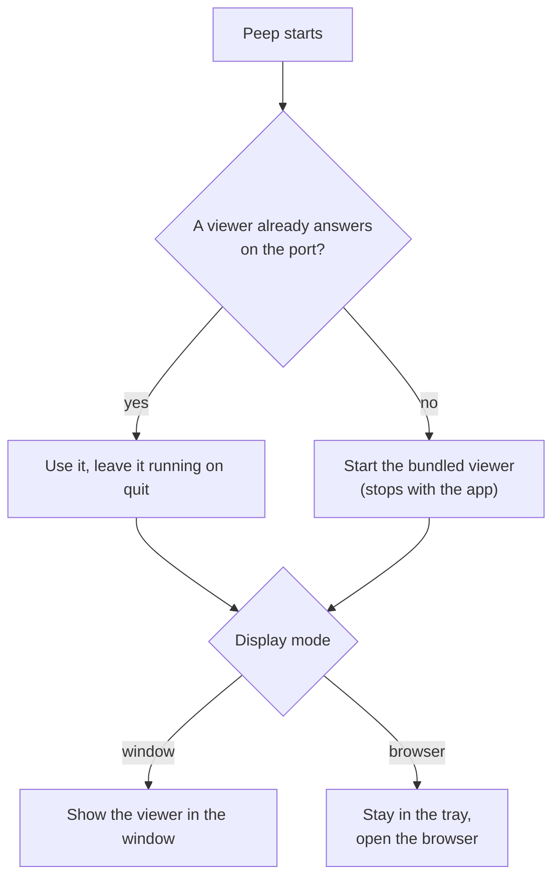

# Desktop app

The desktop app shows the viewer in its own window on macOS, Windows and Linux. It brings its own PHP 8.5, so you do not need PHP 8.5 on your machine to use Peep (your app can run any PHP from 7.1).



## Install

Download it from the [releases page](https://github.com/shibbirweb/peep/releases), under **Assets** of the newest release:

| System | File |
|--------|------|
| macOS on Apple silicon (M1 and later) | `Peep_<version>_aarch64.dmg` |
| macOS on Intel | `Peep_<version>_x64.dmg` |
| Windows | `Peep_<version>_x64-setup.exe` (stable releases also have an `.msi`) |
| Ubuntu, Debian | `Peep_<version>_amd64.deb` (`_arm64.deb` on ARM) |
| Any Linux | `Peep_<version>_amd64.AppImage` (`_aarch64.AppImage` on ARM) |
| Fedora, openSUSE | `.rpm`, stable releases only |

Betas have no `.msi` or `.rpm`, because MSI and RPM versions cannot contain `-beta`. Not sure which Mac you have? Apple menu → **About This Mac** shows the chip.

The app is not signed with an Apple Developer ID or a Windows code signing certificate yet. It is safe to open, but macOS and Windows cannot check who made it, so they stop it the first time. The steps below get past that once; after that it opens like any other app.

### macOS

1. Open the `.dmg` and drag **Peep** into **Applications**.
2. Open Peep from Applications. macOS says *"Peep" Not Opened* (or *cannot be opened because Apple cannot check it for malicious software*). Click **Done**, not *Move to Trash*.
3. Open **System Settings → Privacy & Security** and scroll down to **Security**. Next to *"Peep" was blocked to protect your Mac*, click **Open Anyway**, then enter your password.
4. Open Peep again and click **Open** in the last question.

On macOS 14 (Sonoma) and earlier, steps 2 to 4 can also be done in Finder: Control-click (or right-click) Peep in Applications, choose **Open**, then **Open** again.

If macOS says *"Peep" is damaged and can't be opened*, it is not damaged: macOS marked the download and the app has no signature to clear the mark. Remove the mark in Terminal, then open Peep:

```bash
xattr -dr com.apple.quarantine /Applications/Peep.app
```

### Windows

1. Your browser may say the file is not commonly downloaded. In Edge, open the download's **...** menu, choose **Keep**, then **Show more → Keep anyway**. In Chrome, choose **Keep**.
2. Run `Peep_<version>_x64-setup.exe`. When *Windows protected your PC* (SmartScreen) appears, click **More info**, then **Run anyway**.
3. Follow the installer. Peep starts from the Start menu like any other app.

On Windows 11 with **Smart App Control** on, Windows blocks unsigned apps without a *Run anyway* button. Use `php peep-server.phar serve` (the viewer in your browser) instead, or turn Smart App Control off in **Windows Security → App & browser control → Smart App Control settings** (Windows does not let you turn it back on without reinstalling, so only do this if you are sure).

### Linux

Linux does not check signatures, so there is nothing to allow.

```bash
# Ubuntu, Debian
sudo apt install ./Peep_<version>_amd64.deb

# AppImage, on any distribution
chmod +x Peep_<version>_amd64.AppImage
./Peep_<version>_amd64.AppImage
```

If the AppImage says FUSE is missing, install it: `sudo apt install libfuse2` (on Ubuntu 24.04 and later, `libfuse2t64`).

Once it runs, Peep lives in the tray (the menu bar on macOS).

## Window or browser

Choose in the viewer's **Settings → Display: Open the viewer in**:

- **Desktop window**: the app shows its window.
- **Browser**: the app stays in the tray and opens the viewer in your browser.

`php peep-server.phar serve --open=window` from a terminal opens the desktop app when it is installed, and the browser otherwise.

## The tray

- The number next to the icon is your unread mail and SMS.
- **Show Peep** (or Cmd+Alt+P, Ctrl+Alt+P on Windows and Linux, from anywhere) shows and hides the window.
- **Always on top** keeps the window above your editor.
- **Start at login** starts Peep when you log in.
- **Quit Peep**. Closing the window only hides it.

## Notifications

Turn on **Desktop notifications** in Settings to be told about `peep()->notify(...)` calls and exceptions while the window is in the background. `peep()->showApp()` and `peep()->hideApp()` show and hide the window from your code.

## Alongside the terminal

If a viewer is already running (`php peep-server.phar serve`), the app shows that one and leaves it running when you quit. Otherwise it starts its own and stops it on quit. Settings, history and webhook rules are the same in both, because both use the same settings folder (`~/.config/peep`, or `%APPDATA%\peep` on Windows).

## Updates

The app checks for a new version a little after it starts and then once a day. When there is one, it says so in a notification and the tray item becomes **Update to Peep x.y.z...**: click it to see what is new and install it; Peep restarts into the new version. **Check for Updates...** in the tray (or **Check now** in Settings, Updates) checks at once and says what it found.

In Settings, Updates:

- **Update channel**: *Stable* offers releases from `main`; *Beta* also offers pre-releases from `develop`, to try what comes next.
- **Check for updates at start and once a day**: switch the automatic check off. **Check for Updates...** still works.

A build without an update key (for example one you built yourself) opens the release's download page instead of installing.
