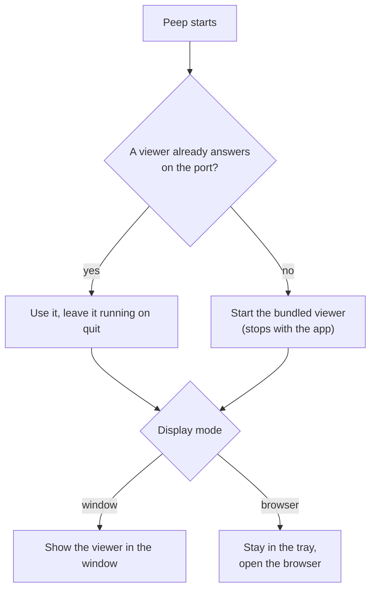

# Desktop app

The desktop app shows the viewer in its own window on macOS, Windows and Linux. It brings its own PHP 8.5, so you do not need PHP 8.5 on your machine to use Peep (your app can run any PHP from 7.1).

## Install

Download it from the [releases page](https://github.com/shibbirweb/peep/releases): `.dmg` for macOS, `.msi` or `-setup.exe` for Windows, `.AppImage`, `.deb` or `.rpm` for Linux (betas have no `.msi` or `.rpm`, because MSI and RPM versions cannot contain `-beta`). Open it; Peep then lives in the tray (the menu bar on macOS).

## Window or browser

Choose in the viewer's **Settings → Display: Open the viewer in**:

- **Desktop window**: the app shows its window.
- **Browser**: the app stays in the tray and opens the viewer in your browser.

`php peep-server.phar serve --open=window` from a terminal opens the desktop app when it is installed, and the browser otherwise.

## The tray

- The number next to the icon is your unread mail and SMS.
- **Show Peep** (or Cmd+Alt+P, Ctrl+Alt+P on Windows and Linux, from anywhere) shows and hides the window.
- **Always on top** keeps the window above your editor.
- **Start at login** starts Peep when you log in.
- **Quit Peep**. Closing the window only hides it.

## Notifications

Turn on **Desktop notifications** in Settings to be told about `peep()->notify(...)` calls and exceptions while the window is in the background. `peep()->showApp()` and `peep()->hideApp()` show and hide the window from your code.

## Alongside the terminal

If a viewer is already running (`php peep-server.phar serve`), the app shows that one and leaves it running when you quit. Otherwise it starts its own and stops it on quit. Settings, history and webhook rules are the same in both, because both use the same settings folder (`~/.config/peep`, or `%APPDATA%\peep` on Windows).

## Updates

The app checks for a new version a little after it starts and then once a day. When there is one, it says so in a notification and the tray item becomes **Update to Peep x.y.z...**: click it to see what is new and install it; Peep restarts into the new version. **Check for Updates...** in the tray (or **Check now** in Settings, Updates) checks at once and says what it found.

In Settings, Updates:

- **Update channel**: *Stable* offers releases from `main`; *Beta* also offers pre-releases from `develop`, to try what comes next.
- **Check for updates at start and once a day**: switch the automatic check off. **Check for Updates...** still works.

A build without an update key (for example one you built yourself) opens the release's download page instead of installing.
