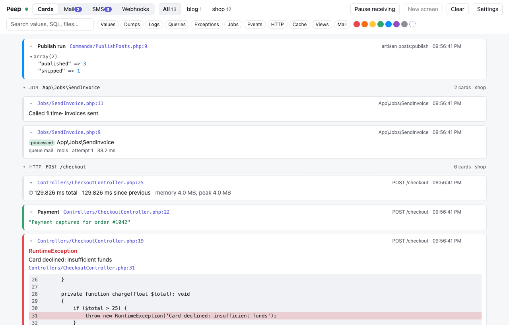
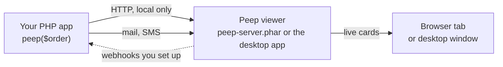

# Getting started

Peep shows what your PHP app is doing in a separate window: values you send with `peep()`, database queries, logs, exceptions, jobs, and the mail and SMS it sends. It works in any PHP app from PHP 7.1 to 8.5, and sets itself up in Laravel.



## How it fits together



The client (`shibbirweb/peep`) lives in your app and sends each call to the viewer. The viewer keeps the cards, the mail and the SMS, and shows them live. When the viewer is not running, the client notices after one try and stays out of the way.

## Five minutes to the first card

1. Start the viewer: open the [desktop app](Desktop-App.md), or run `php peep-server.phar serve` (PHP 8.5). See [Installation](Installation.md).
2. Add the client to your app:

   ```bash
   composer require shibbirweb/peep --dev
   ```

3. Turn it on. Laravel does this outside production. Anywhere else, set `PEEP_ENABLED=true` or add a `peep.php` file returning `['enabled' => true]` (see [Configuration](Configuration.md)).
4. Send something:

   ```php
   peep('Hello');
   peep($user)->green()->label('Signed in user');
   peep()->table($rows, 'Rows');
   ```

The cards appear at once. Each call is one card; the calls of one request, job or command are grouped under it.

## Where next

- [The viewer](The-Viewer.md): groups, filters, search, screens and pausing.
- [Laravel](Laravel.md): queries, jobs, events and mail with no code, and switching query debugging from the viewer ([Query debugging](Query-Debugging.md)).
- [API reference](API-Reference.md): every method of `peep()`.
- [Mail and SMS](Mail-and-SMS.md) and [Webhooks](Webhooks.md): catch what your app sends and test its webhook handlers.
- [AI agents](AI-Agents.md): let Claude Code, Codex, Cursor and other agents debug with Peep and report back.
- [Version support](Version-Support.md): which PHP, Laravel and operating systems are covered.
