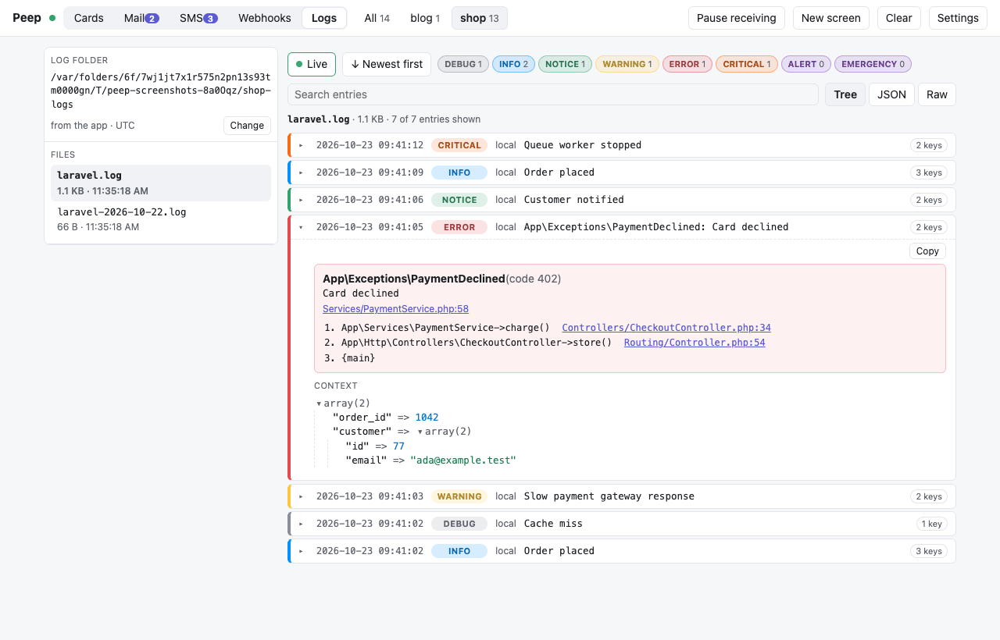

# Logs

The **Logs** tab shows your app's log files (Laravel's `storage/logs`) as clean entries instead of raw text: a colored level, the time, the message, the exception with a clickable stack trace, and the context as a collapsible array or as JSON. You can watch a file live, pause it, and read it newest or oldest first.

## Where the files come from

A Laravel app reports its log folder with every card it sends: `storage/logs`, mapped to your machine with `PEEP_REMOTE_PATH` and `PEEP_LOCAL_PATH` when it runs in Docker. So once the app has sent one card, its project appears in the Logs tab. The viewer reads the files from disk itself, so logs written before Peep was on show up too.

Choose another folder in the tab with **Change** (any app, any framework, as long as it writes Monolog's line format). **Use app's** goes back to the folder the app reports. The choice is kept in the viewer's settings.

| Setting | Does |
|---------|------|
| `log_path` in `config/peep.php` (`PEEP_LOG_PATH`) | Another folder than `storage/logs`; `false` reports none |
| `log_path`, `log_timezone` in `peep.php` (`PEEP_LOG_PATH`, `PEEP_LOG_TIMEZONE`) | The same for apps without Laravel |

Times without an offset are read in the app's time zone (Laravel's `app.timezone`), so "since" filters and the agents' report line up with the cards.

## Reading a file

- Pick the project in the toolbar (or in the tab when several have logs), then a file. The newest file opens by itself.
- **Live** shows new entries as they are written, about once a second; click it to pause. When the file is rotated or cleared, the view starts over.
- **Newest first** or **Oldest first** changes the order. Oldest first follows the end of the file while you are at the bottom.
- The level chips show how many entries each level has and hide or show them. Double-click one to see it and everything more severe (double-click **error** for errors, critical, alert and emergency).
- Search finds text anywhere in an entry, including its context and stack trace.
- Click an entry to open it. **Tree** shows the context as a collapsible array, **JSON** as pretty JSON, **Raw** exactly as written. **Copy** puts the raw entry on the clipboard.
- Big files open at once: the tab reads the newest 500 entries from the end of the file, and **Load older entries** reads the next ones.

| Level | Color |
|-------|-------|
| debug | gray |
| info | blue |
| notice | green |
| warning | yellow |
| error | red |
| critical | orange |
| alert, emergency | purple |

## For AI agents

`vendor/bin/peep logs` and the MCP tool `peep_logs` give agents the same entries as text, and the debug report lists error-level log entries under **Problems**. See [AI agents](AI-Agents.md).

## Safety

The viewer only lists and reads files ending in `.log` directly inside a project's folder, and only the viewer's own machine can ask for them, like the rest of the viewer page.
