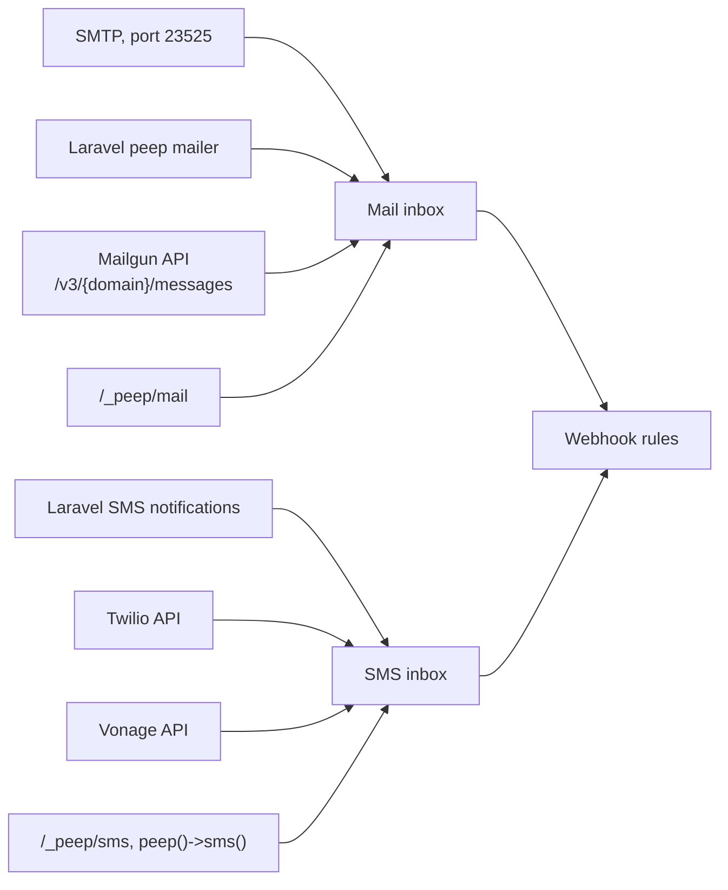
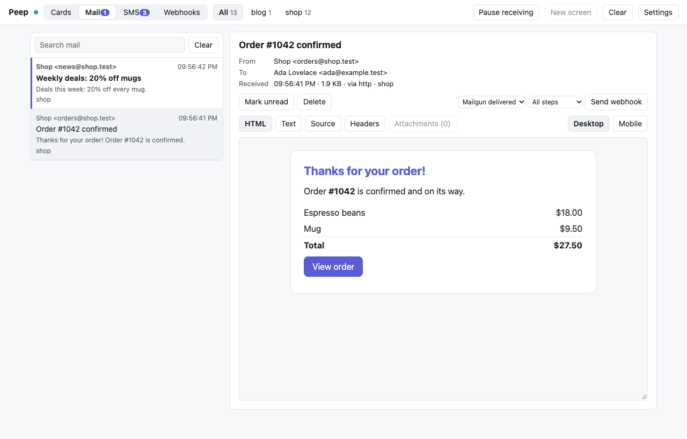
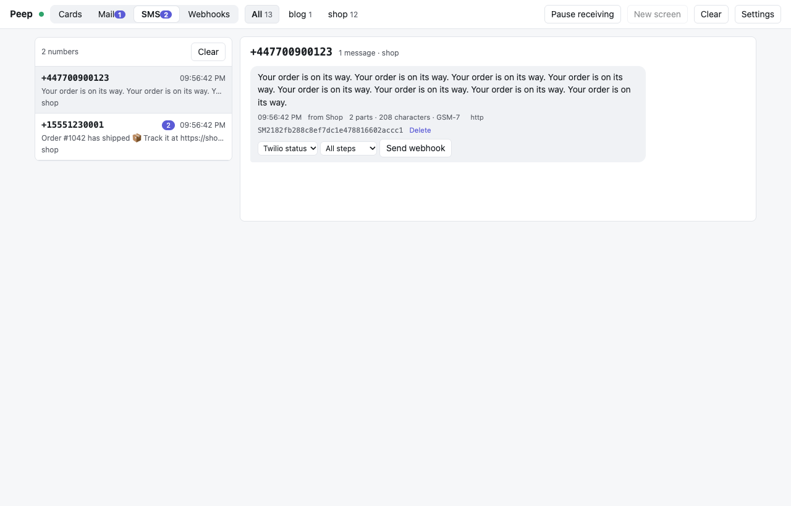
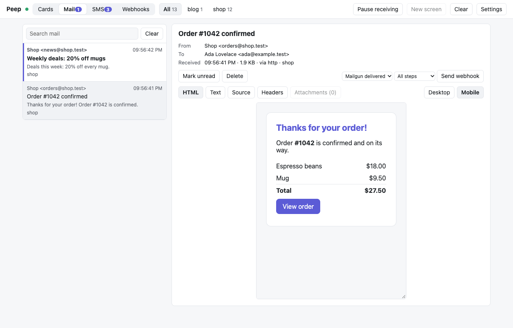

# Mail and SMS

The viewer catches the mail and SMS your app sends, so nothing reaches real people while you develop, and shows them in the Mail and SMS tabs. Each message links back to the request or job that sent it when the app tells Peep which one that was (Laravel does this for you).





## Mail

Pick whichever fits your app.

### SMTP (any app, any language)

The viewer listens for SMTP on port 23525 (change it in Settings). Any username and password work; the username becomes the project.

```dotenv
# Laravel
MAIL_MAILER=smtp
MAIL_HOST=127.0.0.1
MAIL_PORT=23525
MAIL_USERNAME=shop
MAIL_PASSWORD=anything
MAIL_ENCRYPTION=null
```

Peep's port is neither Mailpit's (1025) nor Herd's (2525), so they can run side by side. There is no TLS: the viewer only takes mail from your own machine, unless it has a token (then other machines log in with the token as password).

### The `peep` mailer (Laravel 5.5 to 13)

```dotenv
MAIL_MAILER=peep     # Laravel 7 and newer
MAIL_DRIVER=peep     # Laravel 5.5 to 6
```

No SMTP, no other settings: the package adds the mailer. Each mail goes to the viewer over HTTP, tagged with the request or job that sent it, so "Show request" in the inbox opens that request's queries, logs and exceptions. When the viewer is closed the mail is dropped, like any local mail catcher that is not running.

### Mailgun's API

Apps that call Mailgun's HTTP API can point it at the viewer, which answers like Mailgun:

```php
$mailgun = Mailgun\Mailgun::create('any-key', 'http://127.0.0.1:23517');
$mailgun->messages()->send('mg.example.test', [
    'from' => 'shop@example.test',
    'to' => 'ada@example.test',
    'subject' => 'Hello',
    'html' => '<p>Hello</p>',
]);
```

Laravel's own Mailgun mailer always uses `https://`, so for Laravel use the `peep` mailer or SMTP instead.

### Plain HTTP

```bash
curl -X POST http://127.0.0.1:23517/_peep/mail \
  -H 'Content-Type: application/json' \
  -d '{"from": "shop@example.test", "to": "ada@example.test", "subject": "Hi", "html": "<p>Hi</p>", "project": "shop"}'
```

A raw message works too: `-H 'Content-Type: message/rfc822' --data-binary @message.eml`.

## SMS

### Laravel notifications

SMS notifications on the Vonage (or Nexmo) channel and the [Twilio notification channel](https://github.com/laravel-notification-channels/twilio) show up in the SMS tab with no change. To also stop them from being sent for real while you develop:

```dotenv
PEEP_BLOCK_SMS=true
```

The real send is never blocked in production.

### `peep()->sms()`

For your own SMS code, send the message to the viewer instead of the provider while you develop:

```php
if (app()->isLocal()) {
    peep()->sms($user->phone, "Your code is {$code}", 'Shop');
} else {
    $provider->send($user->phone, "Your code is {$code}");
}
```

### Twilio's and Vonage's APIs

Apps that call these APIs over HTTP with a configurable base URL can point them at the viewer. It stores the SMS and answers like the provider (a Twilio message resource with an `SM...` sid and `status: queued`, or Vonage's message list), so the app goes on normally.

```text
POST http://127.0.0.1:23517/2010-04-01/Accounts/{AccountSid}/Messages.json   (Twilio)
POST http://127.0.0.1:23517/sms/json                                          (Vonage)
```

Send `X-Peep-Project: shop` as a header to pick the project. A Twilio `StatusCallback` is kept with the SMS, for the webhook simulator.

### Plain HTTP

```bash
curl -X POST http://127.0.0.1:23517/_peep/sms -H 'Content-Type: application/json' \
  -d '{"to": "+15551230001", "from": "Shop", "body": "Your code is 482913", "project": "shop"}'
```



The SMS tab shows each number as a thread, with the number of parts the text needs and whether it fits GSM-7 or needs UCS-2 (any emoji or non-Latin letter makes a text UCS-2, which fits 70 characters per part instead of 160).

## The mail inbox

Each mail shows its sender, recipients (Bcc included, from the SMTP envelope), size and how it arrived. **HTML** shows the mail in a sandboxed frame where scripts never run, at desktop width or at a phone's 375 pixels; **Text**, **Source** and **Headers** show the rest, and **Attachments** downloads them. **Show request** opens the cards of the request or job that sent the mail, so you see its queries and logs next to it. **Send webhook** calls a [webhook](Webhooks.md) rule for this mail.



The inbox keeps the last 1,000 mails and 2,000 SMS in memory; a viewer restart empties it.
