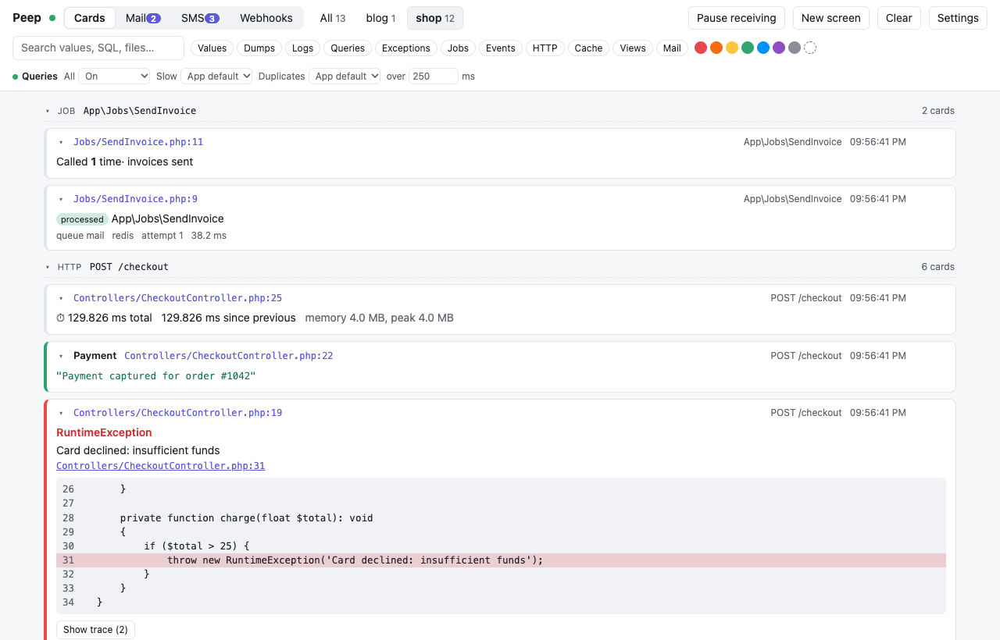
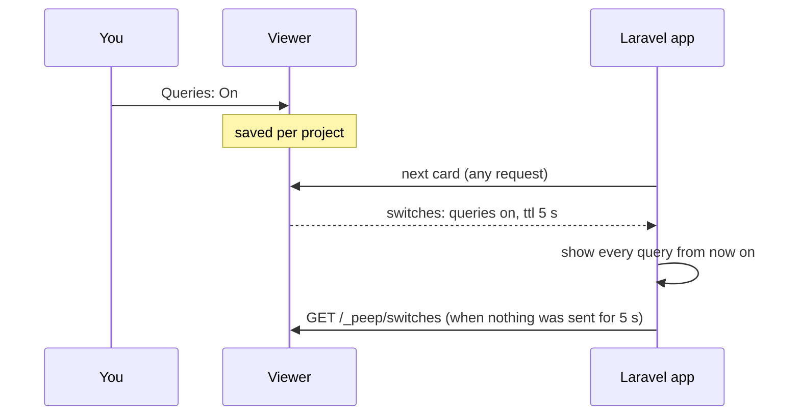

# Query debugging

Peep shows each database query with its bindings filled in, how long it took, and badges for slow queries and repeated (N+1) queries. You can turn query capture on and off from the viewer while your Laravel app runs, without touching code or restarting anything.



## The switches

Select a project (or have only one), and the toolbar shows **Queries**:

| Switch | Does |
|--------|------|
| All | Every query |
| Slow | Queries slower than the threshold in **over ... ms** (empty: the app's `slow_query_ms`) |
| Duplicates | Queries repeated within one request |

Each is **App default** (what `config/peep.php` says), **On** or **Off**. The dot next to *Queries* is green when all queries are on, red when they are off, and gray for the app's default.

## How a running app picks it up



Every answer the viewer gives the app carries the switches, and the app asks again after five seconds of quiet, so a change reaches it within seconds.

## From code

```php
peep()->showQueries();                                   // from here on
peep()->showQueries(fn () => Order::with('items')->get()); // only inside, and returns the result
peep()->showSlowQueries(100);
peep()->showDuplicateQueries();
peep()->countQueries(fn () => $order->load('items'));    // how many queries, and their total time
User::where('active', true)->peep()->get();              // the SQL of one query builder
```

In `config/peep.php`: `send_queries`, `query_types`, `send_slow_queries`, `slow_query_ms` and `send_duplicate_queries`. The viewer's switches win over all of them while they are not *App default*.
