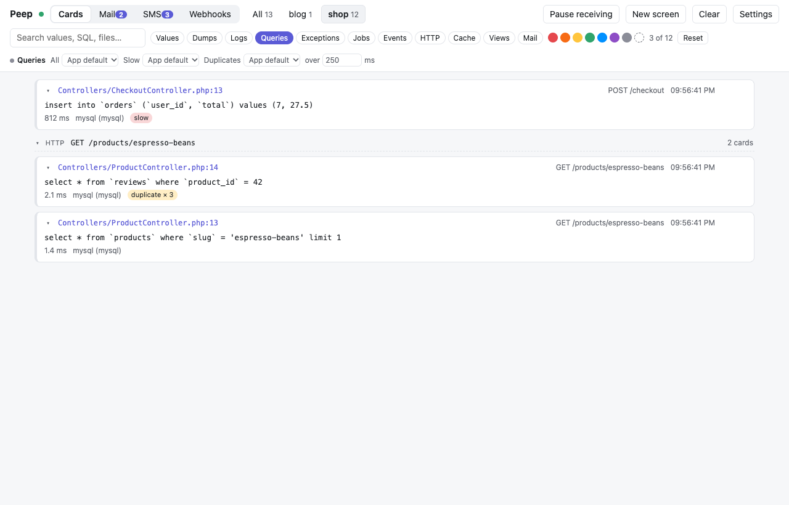
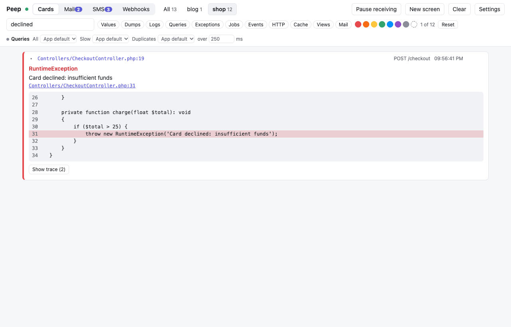
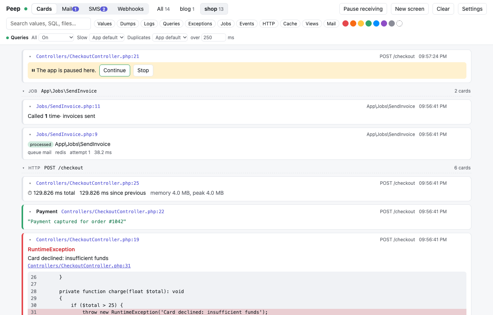
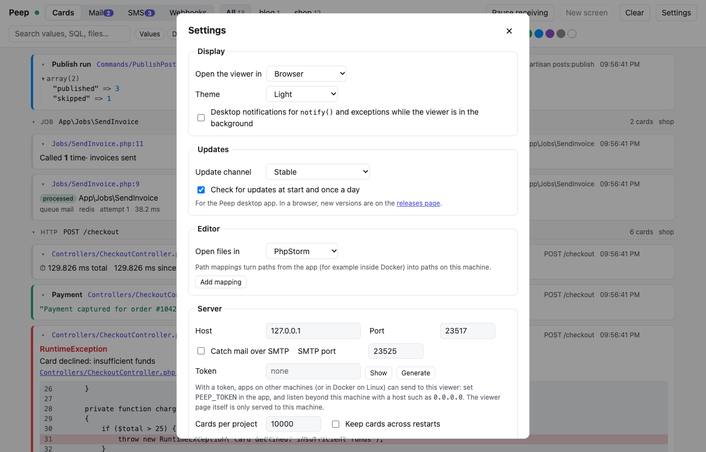
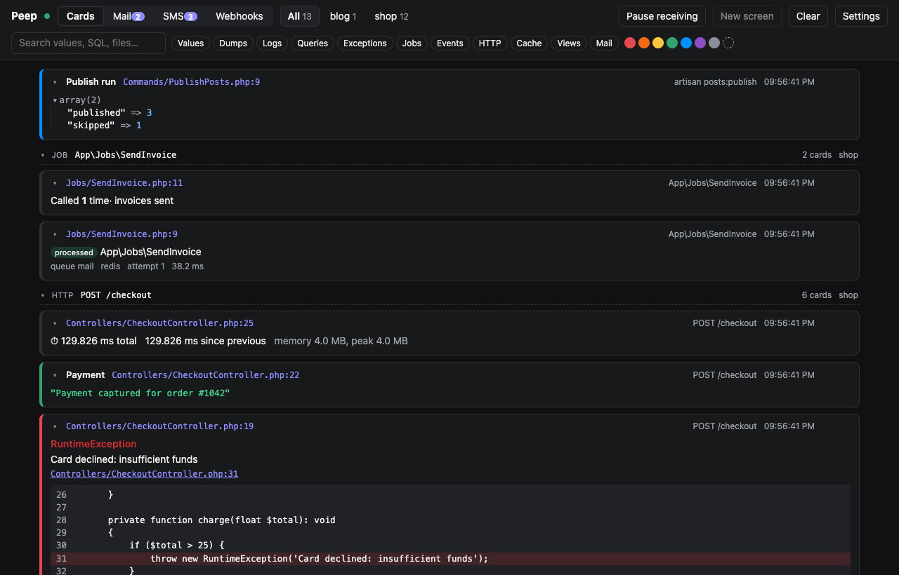

# The viewer

Everything your app sends shows up as cards, newest first. A card is one `peep()` call; later calls on the same card update it in place.

## Requests, jobs and commands

Cards in a row from one HTTP request, queued job or Artisan command get a header with its label (`POST /checkout`) and the number of cards. Click the header to fold the group. Every card also shows where it was called; click the file to open it in your editor (choose the editor in [Settings](#settings)).

## Projects

Every app sends its project name (`PEEP_PROJECT`, or Laravel's `APP_NAME`), and each project gets a tab with its card count. Settings such as the [query switches](Query-Debugging.md) are per project.

## Filters and search

- The chips filter by kind: values, dumps, logs, queries, exceptions, jobs, events, HTTP, cache, views and mail.
- The dots filter by color, including cards with no color.
- The search box looks inside values, SQL, file names and request labels, and filters as you type.

**Reset** clears every filter. **Copy** on a card (it shows when you point at the card) copies it as plain text.

## Screens

- **Clear** removes the cards of the selected project (or all).
- **New screen** moves the cards aside and starts empty; **Previous screens** brings back the last ten per project. `peep()->newScreen('Checkout')` does the same from code, with a title.
- **Pause receiving** ignores everything until you resume, while your app keeps running.

## Pausing the app

`peep()->pause()` stops your app at that line until you click **Continue**. **Stop** ends the request with an exception.

## The list stays fast

The list only draws the cards you can see, so 10,000 cards scroll as smoothly as ten. The viewer keeps 10,000 cards per project (Settings, *Cards per project*) and, with `pdo_sqlite`, brings them back after a restart.

## Settings

The **Settings** button holds the display mode (browser or desktop window), theme, notifications, editor and path mappings, the update channel, and the server's host, port, token, SMTP port and history. They are saved in `~/.config/peep/settings.json` (`%APPDATA%\peep` on Windows), shared by the viewer and the desktop app. Host, port, token, SMTP and history apply after a restart, and the dialog says so.

