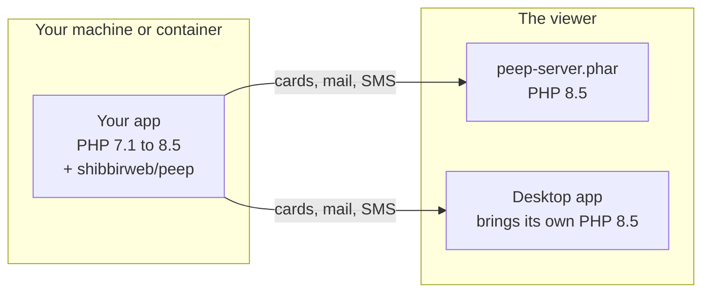

# Version support

Peep has three parts with their own requirements: the client in your app, the viewer, and the desktop app. Every combination below is tested by CI on every change.

## The client (`shibbirweb/peep`)

PHP 7.1, 7.2, 7.3, 7.4, 8.0, 8.1, 8.2, 8.3, 8.4 and 8.5. The same code runs on all of them, and the tests fail on any warning or deprecation, so a new PHP version never brings notices from Peep.

| Package | Versions |
|---------|----------|
| Laravel | 5.5 to 13 |
| Monolog | 1, 2 and 3 |
| psr/log | 1, 2 and 3 |
| Symfony VarDumper | 3.4, 4.4, 5.4, 6.x, 7.x and 8.x |
| Slim | 3 and 4 |
| WordPress | any version on PHP 7.1+ |

## Laravel and PHP

Each Laravel version is tested on every PHP version it supports, from PHP 7.1:

| Laravel | PHP |
|---------|-----|
| 5.5, 5.6, 5.7, 5.8 | 7.1, 7.2, 7.3 |
| 6, 7 | 7.2, 7.3, 7.4, 8.0 |
| 8 | 7.3, 7.4, 8.0, 8.1 |
| 9 | 8.0, 8.1, 8.2 |
| 10 | 8.1, 8.2, 8.3 |
| 11 | 8.2, 8.3, 8.4 |
| 12 | 8.2, 8.3, 8.4, 8.5 |
| 13 | 8.3, 8.4, 8.5 |

Some features need a newer Laravel: the HTTP client watcher needs Laravel 8, `Context` needs Laravel 11, and Laravel 5.5 to 6 use `MAIL_DRIVER` instead of `MAIL_MAILER`. On older versions those parts are skipped; everything else works.

Which part needs which PHP:

## The viewer (`peep-server.phar`)

PHP 8.5 with `mbstring`. `pdo_sqlite` is optional: with it, the cards survive a restart. You only need PHP 8.5 for the viewer, not for your app; the desktop app brings its own.

The viewer page works in current Chrome, Edge, Firefox and Safari.

## The desktop app

| System | Builds |
|--------|--------|
| macOS 11 Big Sur or newer | Apple silicon and Intel |
| Windows 10 and 11 | x64 |
| Linux with WebKitGTK 4.1, such as Ubuntu 22.04 or newer | x64 and arm64 (AppImage, deb, rpm) |

## Releases

Peep follows [semantic versioning](https://semver.org/). Stable releases come from the `main` branch; betas (`1.2.0-beta.1`) come from `develop` and are GitHub pre-releases. The desktop app's update channel picks which it is offered (see [Desktop app](Desktop-App.md#updates)); Composer installs betas only with `"minimum-stability": "beta"`. See the [changelog](../../../CHANGELOG.md) for what each release holds.
