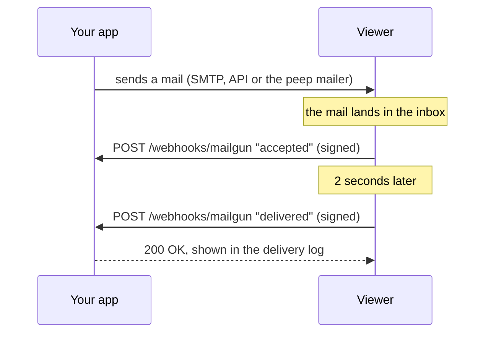
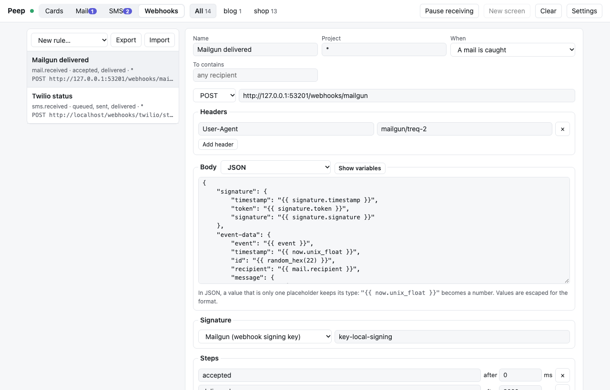
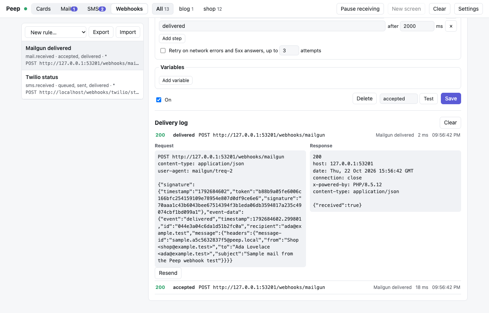

# Webhooks

Providers call your app back after they send something: Mailgun reports a mail as delivered or opened, Twilio reports an SMS as sent and delivered. When Peep catches the mail or SMS instead, the webhook simulator makes those calls, signed the way the provider signs them, so your webhook code runs and its signature check passes.



Open the **Webhooks** tab.



## A first rule

1. Choose **New rule… → Mailgun events**.
2. Set the URL to your app's webhook route, e.g. `http://shop.test/webhooks/mailgun`.
3. Set the signature secret to your local **webhook signing key** (what your app checks against, e.g. `MAILGUN_WEBHOOK_SIGNING_KEY`).
4. Save, then **Test**: a call with sample data goes out, and the delivery log shows the request and your app's answer.

From now on, every mail the viewer catches gets an `accepted` call at once and a `delivered` call two seconds later. Change the steps to simulate other paths, e.g. `accepted`, then `failed`.

## Twilio status callbacks

**New rule… → Twilio status callback**, with your Twilio auth token as the secret. When the app sends an SMS with a `StatusCallback` URL, the calls go to that URL (only if its host is `localhost`, `127.0.0.1`, `*.test` or `*.localhost`); otherwise to the rule's URL. Each call carries `X-Twilio-Signature`, computed over the exact URL called, so Twilio's `RequestValidator` accepts it.

## Sending by hand

Open a mail or SMS in its inbox, pick a rule and an event (for example `opened` or `undelivered`) and click **Send webhook**. Rules with the trigger "Only when sent by hand" appear only there.

## Writing the body

The body is a template. Placeholders are written `{{ ... }}`:

```json
{
  "event": "{{ event }}",
  "message_id": "{{ mail.message_id }}",
  "recipient": "{{ mail.recipient }}",
  "timestamp": "{{ now.unix_float }}",
  "id": "{{ uuid() }}",
  "check": "{{ hmac_sha256(vars.secret, now.unix ~ event) }}"
}
```

- In JSON, a value that is only one placeholder keeps its type: `"{{ now.unix_float }}"` is sent as a number. Everything is escaped for you.
- A form body is written as a JSON object of fields; each value is rendered and URL-encoded.
- XML bodies have every inserted value escaped; raw bodies are sent as written.
- `~` joins text. Functions: `uuid()`, `random_hex(n)`, `random_int(a, b)`, `hmac_sha256(key, data)`, `hmac_sha1`, `sha1`, `sha256`, `md5`, `base64`, `url_encode`, `date('Y-m-d')`, `upper`, `lower`, `json`.
- **Show variables** in the editor lists every variable (`mail.*`, `sms.*`, `now.*`, `vars.*` and more). Unknown names become empty and are listed as warnings in the delivery log.

For a signature of your own, choose **Custom header** and write it as a template; the rendered body is available as `body`:

```text
X-Signature: {{ hmac_sha256(vars.secret, body) }}
```

## With an AI agent

An AI coding agent can send your rules too, to test the app's webhook handler while it fixes it: `vendor/bin/peep send-webhook --rule="Mailgun events" --event=failed --mail=last` sends one call now and shows the app's answer, and `peep webhooks` lists the rules and the delivery log. The MCP tools are `peep_webhooks` and `peep_send_webhook`. The agent never sees a rule's secret and cannot create or change rules. See [AI agents](AI-Agents.md#testing-webhooks).

## Delivery log, retries, sharing rules



- Each call is logged with its request, the response (up to 64 KB), the time it took and any template warnings. **Resend** sends the same request again.
- Turn on **Retry** to repeat calls that failed with a network error or a 5xx answer, after 1, 2, 4... seconds.
- Rules are saved in the viewer's `settings.json`. **Export** downloads them as JSON and **Import** adds rules from such a file, so a team can share them.

The viewer never follows redirects and gives each call 10 seconds.
